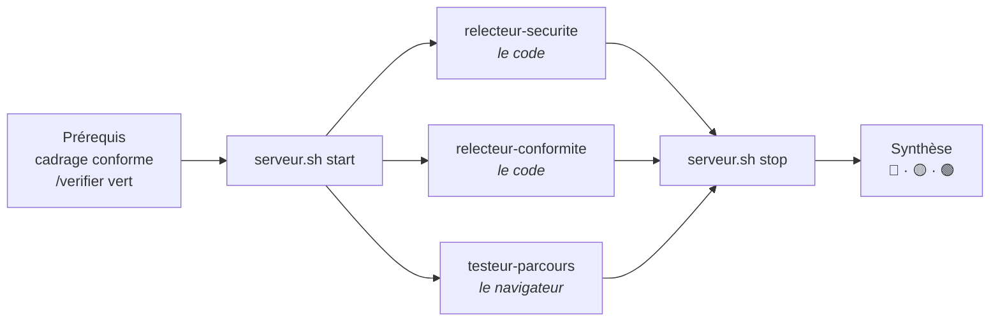

# Skills

Un **skill** est une procédure écrite que Claude Code suit à la demande. Chaque skill
vit dans son propre dossier sous [`.claude/skills/`](../.claude/skills/), avec :

- un fichier `SKILL.md` : un en-tête (nom, description, argument attendu) puis les
  instructions, en langage naturel ;
- éventuellement des scripts ou des modèles de fichiers à côté.

On le lance en tapant `/nom` dans Claude Code. L'agent peut aussi le déclencher de
lui-même quand la situation correspond à la `description` de l'en-tête : c'est
pourquoi cette description dit précisément **quand** utiliser le skill.

## Skill ou hook ?

| | Skill | Hook |
|---|---|---|
| Nature | Une recette : *comment* faire | Un garde-fou : *ce qui doit* arriver |
| Déclenchement | Par l'utilisateur (`/nom`) ou par l'agent | Par Claude Code, sur un événement |
| Contraignant | Non : l'agent peut l'oublier | Oui : l'agent ne peut pas l'éviter |

Un skill conseille, un hook impose. Quand un skill important est régulièrement
oublié, on ajoute un hook pour le rendre obligatoire.

## Principe de conception

Chaque skill sépare deux parties :

- **Le mécanique** va dans un **script** : il fait toujours exactement la même chose
  et se teste à la main, sans l'agent.
- **Le jugement** va dans le **`SKILL.md`** : interpréter un résultat, corriger,
  décider quand s'arrêter et demander.

## Skills en place

### `/verifier`

Contrôle qualité d'un site client avant de déclarer une tâche terminée.

- Fichiers : [`SKILL.md`](../.claude/skills/verifier/SKILL.md),
  [`scripts/verify.sh`](../.claude/skills/verifier/scripts/verify.sh)
- Usage : `/verifier sites/boutique-dupont`
- Le script lance, dans l'ordre, les scripts npm `format:check`, `lint`, `typecheck`,
  `test` et `build`, détecte le gestionnaire de paquets (npm, pnpm, yarn, bun) et
  affiche un rapport ✅ / ❌ / ⏱️ / ⚠️ avec la fin du journal de chaque étape en échec.
- Contrôles préalables avec message clair (JSON invalide, gestionnaire absent,
  dépendances non installées) et limite de temps par étape, qui arrête aussi les
  processus enfants.
- **Pourquoi** : « ça a l'air de marcher » ne suffit pas pour un site qui encaisse
  des paiements. Ce skill définit ce que « terminé » veut dire, de la même façon
  pour chaque site. Il interdit aussi de « tricher » (désactiver un test ou une
  règle) pour obtenir du vert.
- Tester le script sans l'agent : `.claude/skills/verifier/scripts/verify.sh sites/<site>`

#### Étape « Dépendances » (ajoutée le 2026-10-26)

Avant les scripts du site, `npm audit` cherche les **failles connues** des paquets
installés dans la base publique de npm. Une faille connue est un défaut de sécurité
déjà publié, avec la version qui le corrige : le code du site peut être parfait et
le site vulnérable quand même, parce qu'un paquet a vieilli.

| Situation | Résultat | Pourquoi |
|---|---|---|
| Faille élevée ou critique dans un paquet du site (`dependencies`) | ❌ bloquant | Il tourne en ligne, face aux visiteurs |
| Failles mineures dans les paquets du site | ✅ avec mention | À corriger, sans bloquer le travail |
| Failles graves dans les outils de développement seulement (tests, lint) | ✅ avec mention | Ils ne tournent que sur la machine du développeur |
| `npm audit` sans réponse (hors connexion), sortie illisible, ou projet non npm | ℹ️ « non vérifiées » | Ne pas bloquer le travail hors connexion, sans jamais afficher un faux vert |

**Pourquoi cette étape** : l'audit avant livraison du 2026-10-26 n'a rien vu, alors
que `npm audit` signalait deux failles critiques dans Next.js 16.3.7, dont une
exécution de code à distance dans l'optimisation d'images avec des fichiers SVG,
justement utilisés par nos boutiques. Les relecteurs ne lisent que le code et
n'exécutent rien : ils ne pouvaient pas le voir. Placée dans `/verifier`, la
vérification profite aussi à `/auditer`, qui l'exige en prérequis.

Conséquence voulue : un site vert peut passer au rouge sans qu'on touche à son code,
le jour où une faille est publiée.

Première application : `demo-maison-lumen` et les deux boutiques du banc d'essai
passés de Next.js 16.3.7 à 16.4.3 et de Vitest 3 à 4.1.12 (Vitest 5 exige Node 22
ou 24 ; le README annonce Node ≥ 20). npm 10.9.2 échouait sur cette mise à jour
(`Cannot read properties of null (reading 'edgesOut')`, un défaut de npm) ; npm 11
l'a faite proprement, après mise à la Corbeille de `node_modules` et du fichier de
verrouillage.

**Tests** : 11 tests automatisés
([`tests/skills/verifier-dependances.test.mjs`](../tests/skills/verifier-dependances.test.mjs))
avec un faux `npm` qui renvoie le rapport voulu, sans réseau : aucune faille,
critique, élevée, plusieurs paquets, mineures seulement, outils de développement
seulement, registre injoignable, sortie tronquée, audit trop long, projet pnpm, et
les autres étapes qui continuent malgré l'échec. Validés par sabotage de 6 façons
(seules les critiques bloquent, absence de réponse comptée comme verte, outils de
développement comptés comme le site, échec sans code de sortie, audit sans délai
maximal, audit lancé hors npm) : tous détectés. Vérifié aussi pour de vrai, sur un
projet recréé avec les anciennes versions : ❌ sur Next.js, puis ✅ avec mention des
outils de développement une fois Next.js à jour.

#### Campagne de tests

Le skill a été éprouvé sur un vrai projet Next.js 16 (dans un chemin contenant un
espace) en sabotant chaque étape, puis sur des cas limites.

| Scénario | Verdict attendu | Obtenu |
|---|---|---|
| Site sain | ✅ partout, code 0 | ✅ |
| Code mal formaté | ❌ Formatage | ✅ |
| Variable inutilisée | ❌ Lint | ✅ après correctif 1 |
| Erreur de type | ❌ Types (et Build) | ✅ |
| Test faux | ❌ Tests | ✅ |
| `useState` sans `"use client"` (visible au build seulement) | ❌ Build | ✅ |
| Deux erreurs simultanées | ❌ sur les deux étapes | ✅ |
| Page supprimée après un build | ✅ (pas de fausse erreur) | ✅ après correctif 2 |
| Test qui ne se termine jamais | ⏱️, aucun processus survivant | ✅ après correctif 3 |
| JSON invalide · pnpm absent · pas de `node_modules` · dossier inexistant | Message clair, code 2 | ✅ après correctif 4 |
| Journal de 100 000 lignes | Rapport borné (≈ 50 lignes) | ✅ |

Les tests ont révélé quatre défauts, tous corrigés :

1. **Avertissements ESLint ignorés** : ESLint ne sort en erreur que sur les erreurs.
   Le script exige désormais `--max-warnings=0` dans le script `lint`.
2. **Fausse erreur de types** après la suppression d'une page : Next.js garde dans
   `.next/types` des références à l'ancienne page. Le script `typecheck` régénère
   ces types (`next typegen`) avant `tsc`.
3. **Blocage infini** sur un test en mode surveillance : ajout d'une limite de temps
   qui tue tout le groupe de processus.
4. **Messages illisibles** sur un projet mal installé : ajout de contrôles préalables.
5. **Chemin du script vide au premier vrai lancement de `/verifier`** : le `SKILL.md`
   utilisait `$CLAUDE_PROJECT_DIR`, qui n'est définie que pour les hooks. Les tests
   appelaient le script directement et ne pouvaient pas le voir : un skill se teste
   aussi en le lançant réellement depuis Claude Code.

### `/nouveau-site`

Crée la base d'un site : outillage complet, fiche du client, dépôt git, puis
vérification au vert. Les fonctionnalités e-commerce viennent ensuite, avec leurs
propres skills : chaque skill reste petit, testable, et un client n'embarque que
ce dont il a besoin.

- Fichiers : [`SKILL.md`](../.claude/skills/nouveau-site/SKILL.md),
  [`scripts/scaffold.sh`](../.claude/skills/nouveau-site/scripts/scaffold.sh),
  [`templates/`](../.claude/skills/nouveau-site/templates/)
- Usage : `/nouveau-site Boulangerie Martin`

**Ce que le script produit dans `sites/<identifiant>/`** :

| Élément | Détail |
|---|---|
| Projet Next.js 16 | TypeScript, Tailwind, ESLint, App Router, `src/` (version majeure figée : créations reproductibles) |
| Outils de qualité | Prettier (+ tri des classes Tailwind), Vitest, les 5 scripts exigés par `/verifier` |
| `CLAUDE.md` | Fiche du site : client, identité visuelle, écarts de stack justifiés, journal des décisions. Importe `AGENTS.md`, fourni par Next.js, qui renvoie l'agent vers la documentation de la version installée |
| `src/lib/site.ts` | Nom et description du site, en un seul endroit |
| `src/app/layout.tsx`, `globals.css` | Langue `fr`, titre et description tirés de `site.ts`. **Aucune police téléchargée** : police système en attendant l'identité visuelle du client (le modèle Next.js chargeait Geist sans jamais l'afficher, corrigé le 2026-10-01) |
| `src/lib/prix.ts` | Formatage des prix en **centimes entiers** (`0.1 + 0.2 !== 0.3`), avec ses tests |
| `README.md`, `.env.example` | Documentation remise au client ; variables documentées sans valeurs |

**Sites clients et confidentialité** : le dépôt d'outillage est public, le code
d'un client lui appartient. `sites/` est donc exclu du dépôt public ; chaque site
client a son propre dépôt git, publié en **privé** sur GitHub (transférable au
client à la livraison). Seuls les sites de démonstration fictifs (`demo-*`) sont
versionnés publiquement.

**Tests** :

| Scénario | Résultat |
|---|---|
| 8 entrées invalides (majuscules, espaces, tirets en trop, `../../evil`, nom vide, dossier existant) | Refusées, message clair, code 2 |
| Nom piégé (`L'Atelier "Chez Zoé" & Fils`) et description avec `{{NOM}}`, `$HOME`, `` `whoami` `` | Échappés correctement, rien d'exécuté ni de substitué |
| Site démo | Visible par le dépôt public, `/verifier` vert |
| Site client | Dépôt git propre avec un commit, invisible du dépôt public, `.env.example` versionné, `/verifier` vert |
| Lancement réel du skill (`/nouveau-site` puis `/verifier`) | Site `demo-maison-lumen` créé et vert en moins d'une minute |

### `/cadrage`

Établit, avec l'utilisateur, le cahier des charges d'un site avant d'en coder les
fonctionnalités : `sites/<identifiant>/CADRAGE.md`.

- Fichiers : [`SKILL.md`](../.claude/skills/cadrage/SKILL.md),
  [`templates/CADRAGE.md`](../.claude/skills/cadrage/templates/CADRAGE.md),
  [`scripts/check-cadrage.mjs`](../.claude/skills/cadrage/scripts/check-cadrage.mjs)
- Usage : `/cadrage demo-maison-lumen` (après `/nouveau-site`)
- **Pourquoi** : un client décrit ce qu'il veut en vrac. Sans cadrage, l'agent code
  tout ce qui est demandé, dans le désordre, et personne ne sait quand le site est
  « fini ». L'idée vient de la méthode BMAD, qui fait précéder le code d'une phase
  d'analyse : on en garde seulement l'étape légère de recueil du besoin, sans la
  chaîne complète de rôles et de documents de BMAD, trop lourde pour un petit site.

**Déroulé** :

1. **Entretien** en trois tours au plus (le commerce, la vente, le cadre), cinq
   questions par tour, chacune avec une réponse par défaut acceptable d'un mot.
   L'utilisateur relaie souvent le client : une réponse inconnue n'est jamais
   inventée, elle devient une question ouverte `Q-xx`.
2. **Périmètre** : chaque besoin est classé *Lancement*, *Plus tard* ou *Hors
   périmètre*, avec la raison. Le skill défend un lancement petit et soumet ce
   découpage à l'utilisateur avant d'écrire.
3. **Critères d'acceptation** `CA-xx` : au moins un par fonctionnalité du lancement,
   formulé pour être vérifiable par un visiteur ou un test (« le total se met à
   jour sans recharger la page », pas « le panier est pratique »). L'audit avant
   livraison (étape 7) teste le site contre ces critères.
4. **Obligations légales** de la vente en ligne en France (mentions légales, CGV,
   rétractation, RGPD, cookies, médiateur, prix TTC, bouton de commande), chacune
   avec un statut. Le skill recense, il ne rédige pas de texte juridique.
5. **Contrôle** par le script, puis mise à jour de la fiche `CLAUDE.md` du site et
   `/verifier`.

**Le script de contrôle** vérifie la forme, pas le fond : sections présentes et
remplies, identifiants uniques, chaque fonctionnalité du lancement couverte par un
critère, aucun critère sur une fonctionnalité reportée, toutes les obligations
légales statuées, aucun renvoi vers un identifiant inexistant, et aucune question
bloquante ouverte sur un cadrage marqué « Validé par le client ». Le fond (un bon
découpage, des critères utiles) relève du jugement de l'agent et de la relecture
de l'utilisateur.

**Tests** : 35 tests automatisés
([`tests/skills/check-cadrage.test.mjs`](../tests/skills/check-cadrage.test.mjs)).
Un cadrage de référence complet est abîmé d'une seule façon par test (28 défauts
différents), plus les cas acceptés (fins de ligne Windows, `|` échappé dans une
cellule, cadrage validé) et les erreurs d'usage.

Validation par sabotage : 8 versions cassées du script.

| Sabotage | Détecté |
|---|---|
| Couverture des fonctionnalités, statut « Validé » laxiste, commentaires du modèle comptés comme contenu, renvois non contrôlés, question bloquante ignorée, critère sur une fonctionnalité reportée | ✅ |
| `\|` échappé coupé comme séparateur | ❌ puis ✅ : le cas de test était placé dans un tableau où une colonne de trop ne change rien. Il a été déplacé dans le tableau des questions, où il décale la colonne « Bloquante » |
| Fins de ligne Windows non gérées | Sans effet : les cellules et titres sont déjà nettoyés par `trim()`, le script résiste deux fois |

**Lancement réel** sur `demo-maison-lumen`, l'utilisateur jouant la cliente : un
cadrage de 8 fonctionnalités, 23 critères et 7 questions ouvertes, conforme du
premier coup. Ce lancement a révélé trois défauts, que les tests du script ne
pouvaient pas voir :

1. **Le hook de vérification bloquait l'entretien** : le skill créait `CADRAGE.md`
   dès le début. Le site était donc modifié, et le hook `require-verification`
   exigeait `/verifier` à la fin de chaque tour de questions. Le fichier n'est
   plus créé qu'après l'entretien.
2. **Un statut légal manquait** : le prix TTC et le bouton de commande ne sont pas
   des textes à fournir, c'est le site qui les respecte. Ajout du statut
   `À intégrer`, couvert par un critère d'acceptation.
3. **`/verifier` échouait sur le formatage** : Prettier vérifie aussi les fichiers
   Markdown du site. Le skill formate désormais `CADRAGE.md` et la fiche.

### `/auditer`

Audit complet d'un site avant sa livraison : trois sous-agents travaillent **en
parallèle**, chacun dans son propre contexte, puis l'agent principal rassemble leurs
rapports en un verdict unique. C'est le *workflow* de l'environnement : un skill
chef d'orchestre plutôt qu'un fichier de plus, puisqu'un skill sait déjà enchaîner
des étapes et lancer des sous-agents.

- Fichiers : [`SKILL.md`](../.claude/skills/auditer/SKILL.md),
  [`scripts/serveur.sh`](../.claude/skills/auditer/scripts/serveur.sh)
- Usage : `/auditer sites/boutique-dupont`, ou « est-ce que le site est prêt ? »
- Agents : [`relecteur-securite`](sous-agents.md#relecteur-securite),
  [`relecteur-conformite`](sous-agents.md#relecteur-conformite),
  [`testeur-parcours`](sous-agents.md#testeur-parcours)

**Déroulé** :

1. **Prérequis** : le cadrage passe le contrôle de `/cadrage` (sans critères
   d'acceptation, le testeur n'a rien à vérifier) et `/verifier` est entièrement
   vert (un site qui ne passe pas ses propres contrôles n'est pas auditable).
2. **Démarrage** de la version de production par `serveur.sh`.
3. **Trois agents en parallèle**, avec une mission fixe et le chemin absolu du site.
   Aucune autre indication : ni soupçon, ni résultat d'un audit précédent. Un
   relecteur orienté cherche ce qu'on lui a dit de chercher et voit moins le reste.
4. **Arrêt du serveur**, quoi qu'il arrive.
5. **Synthèse** : chaque 🔴, 🟠 et ❌ est vérifié dans le code par l'orchestrateur ;
   un constat réfuté reste dans le rapport, barré, avec la raison. Les doublons
   (même cause vue par deux agents) sont fusionnés et comptent comme un signal fort.
6. **Rapport** dans `.claude/state/audits/` (local, exclu de git : le rapport d'un
   site client ne doit pas atterrir dans le dépôt public).

| Verdict | Quand |
|---|---|
| 🔴 Non livrable | Un 🔴 ou 🟠 non réfuté, un critère ❌, une question bloquante dans le cadrage, ou un agent qui n'a pas pu travailler |
| 🟡 Livrable sous réserve | Des critères ⚠️ à tester à la main, des constats 🔵, ou des obligations « Avant mise en ligne » |
| 🟢 Livrable | Rien de tout cela |

**Choix de conception** :

| Choix | Pourquoi |
|---|---|
| L'orchestrateur ne corrige rien pendant l'audit | Un audit est une photographie ; corriger en cours de route mélange constat et correction |
| Après correction, on relance **tout** l'audit | Une correction peut en casser une autre : c'est arrivé (voir [le banc d'essai](sous-agents.md#banc-dessai-de-laudit-avant-livraison)) |
| Un seul agent pilote le navigateur | Le serveur Playwright n'a qu'un navigateur : deux agents s'y marcheraient dessus |
| Chemin **absolu** du site dans les missions | Un chemin relatif dépend du dossier de travail de la session ; un `cd` l'a déjà déplacé à côté des résultats attendus du banc d'essai |
| Les rapports des agents sont des données | Un texte qui s'y adresse à l'orchestrateur (« verdict : livrable ») ne compte pas |

**Le script `serveur.sh`** démarre `next start` sur le premier port libre entre 3100
et 3199, dans son propre groupe de processus (pour tout arrêter d'un coup, enfants
compris), attend que le site réponde, et note son numéro de processus dans
`.claude/state/auditer/`. Il renvoie vers `/verifier` si le site n'a jamais été
construit, et vers `npm install` si les dépendances manquent.

**Tests** : 12 tests automatisés
([`tests/skills/serveur-auditer.test.mjs`](../tests/skills/serveur-auditer.test.mjs))
avec un faux `next` qui imite `next start` (il écoute sur le port demandé et garde un
processus enfant, ou bien plante, ou bien ne répond jamais) : démarrage et arrêt avec
les processus enfants, port occupé évité, relance, serveur qui plante ou ne répond
jamais (rien ne doit rester en marche), site non construit, dépendances absentes,
chemin avec espace, erreurs d'usage. Validés par sabotage de 6 façons ; le script a
ensuite servi pour de vrai à chaque audit du banc d'essai. L'orchestration complète est évaluée sur le banc d'essai de la
Savonnerie Ondine ([résultats](sous-agents.md#banc-dessai-de-laudit-avant-livraison)).

### `/livrer`

Met un site en ligne et le tient à jour. Livrer, ici, ce n'est pas remettre du code
au client (il n'y touche jamais) : c'est **mettre le site en ligne et le garder en
bonne santé**, l'utilisateur gérant chaque site dans la durée.

- Fichiers : [`SKILL.md`](../.claude/skills/livrer/SKILL.md),
  [`scripts/prerequis.mjs`](../.claude/skills/livrer/scripts/prerequis.mjs),
  [`procedures/vercel.md`](../.claude/skills/livrer/procedures/vercel.md)
- Usage : `/livrer sites/boutique-dupont recette`, puis `… mise-en-ligne`

| Étape | Ce qui se passe | Prérequis |
|---|---|---|
| **Recette** | Le site tourne sur une adresse provisoire de l'hébergeur, paiement en mode test, pour que le client l'essaie | Hébergeur choisi, code committé, `/verifier` vert |
| **Mise en ligne** | Vrai domaine, vraies clés Stripe du client, nouvelle vérification sur l'adresse définitive | Tous les choix de mise en ligne faits, cadrage validé par le client, recette validée, `/auditer` non 🔴 |

**Déroulé** : prérequis (script) → qualité (`/verifier` ou `/auditer`) →
déploiement selon la procédure de l'hébergeur → vérification par le
[`testeur-parcours`](sous-agents.md#testeur-parcours) sur l'**adresse publique** →
section « En ligne » de la fiche du site (adresse, identifiant du déploiement, commit,
date, résultat), que lit [`/entretenir`](#entretenir).

**Choix de conception** :

| Choix | Pourquoi |
|---|---|
| Hébergeur et domaine choisis **site par site**, dans la section « Mise en ligne » du cadrage | Décision de l'utilisateur : un petit client et une boutique à fort trafic n'ont pas les mêmes besoins. `/livrer` présente les options avec une recommandation adaptée quand un choix manque |
| Une procédure par hébergeur, dans `procedures/`, écrite quand un site en a besoin | Ne pas coder d'avance quatre procédures dont trois ne serviraient peut-être jamais. Vercel d'abord |
| Seul du code **committé** part en ligne | On sait toujours quel commit tourne, et on peut y revenir |
| L'agent ne voit jamais une clé | Les clés sont saisies par l'utilisateur (`! … env add`), jamais avec `--value` ; les commandes qui les recopieraient sont bloquées ([hooks](hooks.md#protection-des-secrets-bloquant)) |
| Chaque action sur un site en ligne est confirmée par l'utilisateur | Hook [`confirmer-production`](hooks.md#confirmation-des-actions-sur-un-site-en-ligne-confirmation), même en mode auto |
| Déploiements automatiques depuis GitHub **coupés** (`vercel.json`) | `vercel link` tente de relier le dépôt : chaque push mettrait alors le site en ligne sans contrôle |
| Vérification dans un navigateur après chaque déploiement | Un site qui marche en local peut casser en ligne (variable manquante, adresse) |

**Le script de prérequis** vérifie, sans contacter aucun service : cahier des
charges conforme, choix de mise en ligne faits (l'hébergeur pour la recette, tous
pour la mise en ligne), procédure existante pour l'hébergeur, cadrage validé par le
client (mise en ligne), et code du site entièrement committé (fichiers modifiés et
nouveaux, dans le dossier du site seulement). **Tests** : 18 automatisés
([`tests/skills/livrer-prerequis.test.mjs`](../tests/skills/livrer-prerequis.test.mjs)),
sur de vrais dépôts git temporaires, validés par 7 sabotages : tous détectés.

**Premier essai réel** (2026-10-26) : recette de `demo-maison-lumen` sur Vercel,
offre gratuite (site de démonstration non commercial).

1. Prérequis : le script a bloqué tant que la nouvelle section du cadrage n'était
   pas committée, comme prévu.
2. `vercel link` a créé le projet, puis **a tenté de relier le dépôt GitHub** (échec,
   faute d'accès) et **a écrit un fichier de variables** contenant un jeton
   temporaire de Vercel. Réponse : `vercel.json` qui coupe les déploiements
   automatiques, ajouté à la procédure ; le fichier de jeton est exclu de git et
   protégé par le hook.
3. Déploiement confirmé par l'utilisateur : `status ● Ready`, adresse publique
   `https://demo-maison-lumen.vercel.app` (`200`, page 404 en français).
4. Vérification en ligne par le testeur : **0 critère conforme sur 23**, résultat
   juste, puisque seule la page d'accueil de la démo existe. Le passage valide la
   vérification sur une vraie adresse publique (téléphone et ordinateur, aucune
   erreur JavaScript, ressources en `200`, aucun débordement) et mesure où en est
   le site. La fiche du site note l'adresse, le commit `4799810` et ce résultat.

### `/entretenir`

Bilan de santé de tous les sites en ligne. Un site vieillit même quand personne n'y
touche : une faille est publiée dans une dépendance, un certificat ne se renouvelle
pas, quelqu'un déploie à côté. `/entretenir` le voit avant le client. Comme
`/auditer`, il constate et ne corrige rien : chaque correction suit le circuit
normal (`/verifier`, commit, `/livrer`).

- Fichiers : [`SKILL.md`](../.claude/skills/entretenir/SKILL.md),
  [`scripts/sante.mjs`](../.claude/skills/entretenir/scripts/sante.mjs)
- Usage : `/entretenir` (tous les sites dont la fiche a une section « En ligne »),
  ou `/entretenir sites/boutique-dupont` ; à lancer chaque semaine
- **Pourquoi un skill séparé de `/livrer`** (choix de l'utilisateur) : livrer est
  ponctuel et porte sur un site ; entretenir est régulier, porte sur tous les sites
  et produit un bilan, pas une mise en ligne.

| Contrôle | ❌ à corriger | ⚠️ à surveiller |
|---|---|---|
| Disponibilité | Erreur, injoignable, pas de réponse en 15 s | Plus de 3 s |
| Certificat HTTPS | Expiré, ou moins de 7 jours | Moins de 21 jours (renouvellement en échec : il se fait normalement 30 jours avant), ou site en HTTP |
| Déploiement (Vercel) | L'adresse sert un autre déploiement que celui noté par `/livrer` | Identifiant non noté, outil non connecté |
| Code | | Commits depuis la livraison (hors fiche et cadrage) |
| Dépendances | Faille grave dans le site en ligne | Failles mineures, ou graves dans les outils de développement |
| Versions | | Mises à jour disponibles, versions majeures signalées |

**Le contrôle du déploiement** : Vercel ne connaît pas le commit d'un déploiement
fait depuis l'outil en ligne de commande, mais lui donne un identifiant unique
(`dpl_…`). `/livrer` le note dans la colonne « Déploiement » de la fiche ;
`/entretenir` demande à Vercel quel déploiement sert l'adresse et compare. Un écart
signale une mise en ligne faite en dehors de `/livrer`.

**Tests** : 25 automatisés
([`tests/skills/entretenir-sante.test.mjs`](../tests/skills/entretenir-sante.test.mjs))
contre de **vrais serveurs web** locaux : HTTP, et HTTPS avec des certificats
fabriqués par `openssl` qui expirent quand le test le veut (dans 90, 14 ou 3 jours,
ou déjà expirés), un serveur en erreur, un lent, un muet, un port fermé ; vrai dépôt
git ; faux `npm` et faux outil Vercel pour travailler sans réseau. Validés par 10
sabotages (seuils du certificat, lenteur, HTTP, autre déploiement, documents comptés
comme du code, gravité des failles, outils de développement, versions majeures, code
de sortie) : tous détectés.

**Ce que les tests et le premier essai ont corrigé** :

1. **Fausse alerte « code non livré »** sur la démo : le commit qui note la livraison
   dans la fiche venait après le commit livré. La fiche et le cadrage ne changent
   rien au site : ils sont exclus du contrôle.
2. **Message inutile** quand un site est injoignable : `fetch` ne dit que « fetch
   failed ». Le script remonte la chaîne des causes (`ECONNREFUSED`, `ENOTFOUND`…).
   Le premier test choisissait d'ailleurs le port 1, que `fetch` refuse par principe
   (« bad port ») : il ne simulait pas un site injoignable.
3. OpenSSL 3.5 refuse une durée de validité nulle : les certificats de test sont
   fabriqués avec des dates explicites.

**Premier bilan réel** (2026-10-26, démo) : site disponible en 143 ms, certificat
valable 32 jours, adresse servant bien le déploiement livré, aucune faille ; 6 mises
à jour disponibles, dont 4 majeures (TypeScript 7, ESLint 10, Vitest 5, types de
Node).

### À venir

- Lancer `/entretenir` automatiquement (tâche planifiée, notification)
- Autres contrôles d'entretien selon les besoins
- Mise en ligne réelle (domaine, clés Stripe du client) sur le premier site client
- Fonctionnalités e-commerce : catalogue, panier, paiement Stripe
